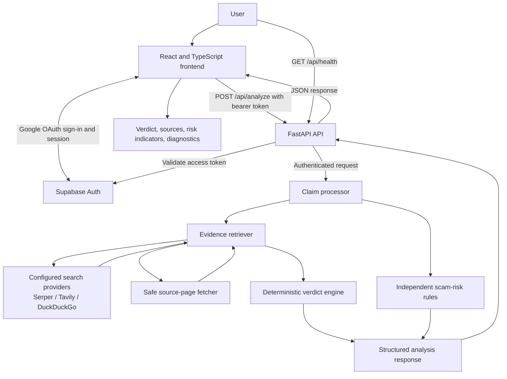

# TrustLens AI

[](https://www.python.org/)
[](https://fastapi.tiangolo.com/)
[](https://react.dev/)
[](https://www.typescriptlang.org/)
[](https://vite.dev/)
[](https://supabase.com/)
[](https://www.docker.com/)

TrustLens AI is an evidence-assisted financial misinformation and scam-intelligence application. It accepts a financial claim or suspicious message, extracts candidate assertions, searches configured providers for evidence, returns an evidence-based factual assessment, and independently flags behavioral scam indicators.

The project is intended to help people investigate viral financial posts, investment promotions, rumors, and urgent messages before acting on them. It is an investigative aid—not a guaranteed fraud detector, a legal finding, or financial advice.

> **Implementation note:** The current claim extraction, baseline verdict matching, and scam-risk scoring are deterministic rules. The application does not currently use an LLM or a trained machine-learning model to produce its verdicts. External search services supply evidence; they do not make the verdict.

## Table of Contents

- [Problem Statement](#problem-statement)
- [Why We Built TrustLens AI](#why-we-built-trustlens-ai)
- [Project Objectives](#project-objectives)
- [Features](#features)
- [Verdict System](#verdict-system)
- [Scam-Risk Assessment](#scam-risk-assessment)
- [Architecture](#architecture)
- [Technology Stack](#technology-stack)
- [Repository Structure](#repository-structure)
- [Prerequisites](#prerequisites)
- [Local Installation and Setup](#local-installation-and-setup)
- [Environment Configuration](#environment-configuration)
- [Running with Docker](#running-with-docker)
- [API Reference](#api-reference)
- [Testing and Quality Assurance](#testing-and-quality-assurance)
- [Security Considerations](#security-considerations)
- [Current Limitations](#current-limitations)
- [Future Enhancements](#future-enhancements)
- [Responsible Use and Disclaimer](#responsible-use-and-disclaimer)
- [Contributing](#contributing)
- [License](#license)
- [Project Status and Links](#project-status-and-links)

## Problem Statement

Financial misinformation and scam attempts often arrive through social media, messaging apps, and forwarded emails. A message may claim that an account will be blocked, promise unusually high returns, or attribute a new rule to a regulator. Recipients may have little time or context to find out whether the claim is supported.

Several problems make these messages difficult to assess:

- Trustworthy source material can be difficult to locate quickly.
- A claim may combine accurate details with unsupported or misleading statements.
- A factual claim and the behavior requested by a message are different questions. A message can quote a real policy while attaching a suspicious payment link.
- Search results can be incomplete, unavailable, outdated, or inconclusive. Finding no corroboration is not proof that a claim is false.

TrustLens AI presents evidence and uncertainty alongside its assessments so users can investigate rather than treating an unsupported claim as established fact.

## Why We Built TrustLens AI

Simple keyword matching cannot establish whether a financial statement is true. TrustLens AI is designed to inspect the available evidence and show what the application found, which assertions were extracted, and where evidence came from.

The implementation emphasizes:

- **Evidence-backed assessments:** verdict logic uses retrieved evidence rather than model confidence alone.
- **Source transparency:** results include source URLs, provider attribution, source-quality labels, and whether text came from a search snippet or fetched page.
- **Claim-level analysis:** submissions are split into candidate assertions so evidence coverage can be shown at a more specific level.
- **Honest uncertainty:** insufficient evidence remains `UNVERIFIED`.
- **Independent assessments:** factual accuracy and behavioral scam risk are calculated separately.

These are design goals, not claims of perfect accuracy or measured real-world impact.

## Project Objectives

The current implementation aims to:

- Accept financial claims and suspicious messages up to 5,000 characters.
- Normalize submitted text and extract candidate factual assertions using deterministic patterns.
- Retrieve relevant evidence through configured search providers and attempt safe extraction from selected source pages.
- Compare assertions with available evidence and return a structured verdict, explanation, evidence, and diagnostics.
- Assess scam-risk signals separately from factual accuracy.
- Provide a React web interface for sign-in and analysis.
- Offer Google sign-in through Supabase Auth and require a validated Supabase access token for analysis requests.
- Expose a public health endpoint and automated backend/frontend checks.

The project does not currently provide persistent analysis history, a trained AI model, or a guarantee that every claim or scam will be detected.

## Features

- **Claim submission and processing:** validates, normalizes, and splits text into candidate assertions using rule-based processing. It is not a general-purpose semantic NLP system.
- **Configurable evidence search:** supports Serper, Tavily, DuckDuckGo, and a no-op mode. Serper and Tavily need API keys; DuckDuckGo does not require a key but can still be blocked or unavailable. Provider order and fallback are configurable.
- **Source-page extraction:** selected search results may be fetched and parsed as HTML or plain text. The response distinguishes fetched page text from the original search snippet and reports fetch failures.
- **Evidence-grounded verdict:** a deterministic baseline compares assertions with evidence and returns `TRUE`, `FALSE`, `PARTIALLY_TRUE`, or `UNVERIFIED`; operational failures may return `ERROR`.
- **Evidence display and diagnostics:** the UI presents sources and assertion details; API results include provider attempts, assertion coverage, evidence counts, limitations, and processing notes.
- **Independent scam-risk assessment:** a deterministic heuristic identifies behavioral patterns such as payment demands, urgent threats, credential requests, suspicious links, impersonation, app installation or remote-access requests, transfer instructions, pressure tactics, and guaranteed returns.
- **Google sign-in:** the frontend uses Supabase Auth's Google OAuth flow. The analysis endpoint checks the bearer access token server-side.
- **Protected analysis endpoint:** analysis requires a valid user session and is subject to a bounded, per-process per-user rate limit.
- **Frontend and API feedback:** the web application reports authentication, network, validation, and server errors. Backend errors avoid returning internal stack traces.
- **Health endpoint:** a public endpoint reports backend status and application metadata.
- **Responsive web interface:** the UI uses responsive CSS layouts for the analyzer and related views; visual behavior may vary by screen and browser.
- **Container build:** a multi-stage Dockerfile builds the frontend and packages it with the FastAPI application. Deployment verification is still pending; see [Running with Docker](#running-with-docker).

## Verdict System

The verdict engine assigns factual outcomes based on the evidence it receives:

| Verdict | Meaning in this implementation |
| --- | --- |
| `TRUE` | The material assertion(s) are supported by evidence that meets the engine's decisive checks. |
| `FALSE` | Evidence directly contradicts the material assertion(s) under the engine's checks. |
| `PARTIALLY_TRUE` | Evidence supports some assertions while other assertions are contradicted or lack important context. |
| `UNVERIFIED` | Evidence is absent, insufficient, or inconclusive for a defensible conclusion. |
| `ERROR` | The verification pipeline could not complete normally. This is an operational outcome, not a factual finding. |

These are automated assessments, not guarantees of correctness. A verdict depends on the evidence retrieved and the current deterministic comparison logic. Conflicting or incomplete evidence must not be treated as proof. In particular, `UNVERIFIED` does **not** mean that a claim is false.

The current baseline is not a general semantic reasoner: it combines explicit checks for some supported propositions with surface-level terms and signals for other assertions. It can miss context, dates, jurisdiction, or nuances and can misinterpret text. See [Current Limitations](#current-limitations).

## Scam-Risk Assessment

Scam risk answers a different question from factual verification: **does the submitted message contain behavioral patterns associated with scams?** It does not determine whether its factual statements are true or whether a sender has committed fraud. A factually accurate statement may be paired with a fraudulent payment request; a suspicious wording pattern is not, by itself, proof of fraud.

The rule-based detector assigns at most one weight per indicator family when any pattern in that family matches. It adds the detected weights and caps the score at 100:

| Indicator family | Weight |
| --- | ---: |
| Payment demand | 35 |
| Urgent threat | 30 |
| Credential request | 40 |
| Suspicious link | 25 |
| Institutional impersonation | 30 |
| App installation or remote access | 30 |
| Transfer request | 35 |
| Pressure tactic | 20 |
| Guaranteed return | 25 |

The displayed categories are `LOW` (0–29), `MEDIUM` (30–59), and `HIGH` (60–100). The score is a heuristic, **not a probability**, and has not been statistically calibrated. Legitimate messages may trigger rules, novel or non-English scams may not, and a low score does not establish safety. The detector's explanation and matched indicators should be reviewed alongside the message.

## Architecture



### Request flow

1. The user signs in with Google through Supabase Auth. The frontend keeps the Supabase session and sends its access token with analysis requests.
2. FastAPI validates the token using the configured Supabase Auth user endpoint, then applies the process-local per-user rate limit.
3. The claim processor validates and normalizes the message and extracts candidate assertions.
4. The evidence retriever searches providers in configured order, applies controlled fallback/corroboration behavior, and may fetch selected source pages.
5. The verdict engine evaluates available evidence. The scam detector separately scores the normalized submitted text; this score does not affect the factual verdict.
6. FastAPI maps the result into a typed JSON response and the frontend displays it.

Supabase is used for authentication, not as an application database. The application currently does not persist analysis reports or evidence history.

## Technology Stack

| Technology | Purpose in TrustLens AI |
| --- | --- |
| Python 3.12 | Backend runtime used by the CI workflow and Docker image. |
| FastAPI and Uvicorn | HTTP API, request handling, and ASGI server. |
| Pydantic and Pydantic Settings | Request/response validation and environment-driven backend configuration. |
| HTTPX and HTTP Core | Search-provider, source-page, and Supabase Auth HTTP requests; HTTP Core is also used for validated network connections. |
| BeautifulSoup and lxml | Extract readable text and metadata from fetched HTML pages. |
| React 19 and TypeScript | Interactive browser interface and typed API integration. |
| Vite 8 | Frontend development server and static production build; development proxies `/api` to the backend. |
| Supabase Auth and `@supabase/supabase-js` | Google OAuth session in the browser and server-side validation of Supabase access tokens. No Supabase database integration is used. |
| Serper | Optional keyed search provider. |
| Tavily | Optional keyed search provider. |
| DuckDuckGo | Search fallback that does not require an API key; availability depends on the external service. |
| Docker and Docker Compose | Multi-stage frontend/backend image build and single-service container configuration. |
| Pytest | Backend unit, regression, and API tests. |
| Oxlint | Configured frontend linter (`npm run lint`). |
| GitHub Actions | CI workflow configured for backend tests, frontend checks, Docker build, and container health testing. The workflow has not yet been confirmed by an actual GitHub Actions run. |

Search API keys are optional; Python and frontend dependencies are defined in the repository manifests. The backend requirements are version-ranged and are not currently hash-locked.

## Repository Structure

```text
TruthLensAI/
├── .github/workflows/ci.yml       # CI checks and container health job
├── .env.example                   # Docker Compose/public frontend placeholders
├── .dockerignore
├── Dockerfile                     # Multi-stage frontend build and backend image
├── docker-compose.yml
├── README.md
├── audit/deployment_readiness/    # Readiness report, checklist, test evidence
├── backend/
│   ├── .env.example               # Backend configuration template
│   ├── app.py                     # FastAPI app, CORS, routes, static frontend mount
│   ├── config.py                  # Environment-backed settings
│   ├── requirements.txt
│   ├── api/                       # Routes, auth, rate limit, Pydantic schemas
│   ├── core/                      # Claim extraction, domain models, verdict/risk rules
│   ├── database/                  # Database package placeholder; persistence is not active
│   ├── services/                  # Search, source fetching, verification orchestration
│   └── tests/                     # Unit, regression, security, and opt-in integration tests
├── docs/                          # Architecture, auth, deployment, and scope documents
├── frontend/
│   ├── .env.example
│   ├── package.json
│   ├── vite.config.ts
│   └── src/
│       ├── components/            # Landing, auth, analysis, evidence, and result views
│       ├── services/              # API client and Supabase client
│       └── types/                 # API response TypeScript types
├── manual_tests/                  # Explicitly opt-in live smoke tests
└── pytest.ini
```

## Prerequisites

For local development:

- Git.
- Python 3.12 (the CI workflow and backend container use Python 3.12).
- Node.js 22 and npm (the CI workflow and frontend build container use Node.js 22).
- A Supabase project with Google OAuth configured if you want to sign in and call the analysis endpoint.
- Optional: a Serper or Tavily API key. DuckDuckGo can be used without a key, subject to service availability.

For container execution, install Docker Engine/Desktop with Docker Compose. The image build also needs the public Supabase frontend URL and publishable key. Search credentials are optional and should be provided only as backend runtime configuration.

## Local Installation and Setup

The following commands use Windows PowerShell. Open two terminals: one for FastAPI and one for Vite.

### 1. Clone the repository

```powershell
git clone https://github.com/ShewaleParth/Truth-Lens-AI.git
Set-Location Truth-Lens-AI
```

### 2. Create and activate a Python environment

```powershell
py -3.12 -m venv .venv
.\.venv\Scripts\Activate.ps1
python -m pip install --upgrade pip
python -m pip install -r backend\requirements.txt
```

If PowerShell blocks activation, allow it for the current terminal only and activate again:

```powershell
Set-ExecutionPolicy -Scope Process -ExecutionPolicy Bypass
.\.venv\Scripts\Activate.ps1
```

### 3. Configure the backend

```powershell
Copy-Item backend\.env.example backend\.env
notepad backend\.env
```

Set `SUPABASE_URL` and `SUPABASE_PUBLISHABLE_KEY` for the Supabase project used by the frontend. Set provider keys only if using Serper or Tavily. For a local no-search setup, set `SEARCH_PROVIDER_ORDER=none`; health checks still work, but analysis has no live evidence and will generally be `UNVERIFIED`.

### 4. Configure and install the frontend

In the second terminal, from the repository root:

```powershell
Set-Location frontend
Copy-Item .env.example .env
notepad .env
npm ci
```

Set `VITE_SUPABASE_URL` and `VITE_SUPABASE_PUBLISHABLE_KEY`. The Vite development server proxies `/api` to `http://127.0.0.1:8000`, so `VITE_API_BASE_URL` can remain empty for local development.

### 5. Configure Google OAuth

In the Supabase dashboard, enable Google under **Authentication → Sign In / Providers**, configure the Google OAuth client credentials, and register the Supabase callback URL shown by the dashboard with the Google OAuth client. Add the local frontend URL you actually open (normally `http://127.0.0.1:5173` or `http://localhost:5173`) to Supabase's allowed redirect URLs. Exact provider credentials and redirect settings are managed in Supabase/Google dashboards, not in this repository.

### 6. Start the application

In the first terminal, from the repository root with the virtual environment active:

```powershell
python -m uvicorn backend.app:app --host 127.0.0.1 --port 8000 --reload
```

In the second terminal, from `frontend\`:

```powershell
npm run dev -- --host 127.0.0.1
```

Open the Vite URL printed in the terminal (normally `http://127.0.0.1:5173`). The backend health endpoint is `http://127.0.0.1:8000/api/health`. Analysis requires a valid Google/Supabase session; the health endpoint does not.

## Environment Configuration

Backend settings are read from the repository-root `.env` or `backend\.env`. Frontend settings are read from `frontend\.env`; Vite variables are compiled into browser code. The root `.env.example` is for Docker Compose build-time/frontend values.

| Variable | Component | Required? | Purpose and default |
| --- | --- | --- | --- |
| `ENVIRONMENT` | Backend | No | Runtime mode; defaults to `development`. Production mode requires server Supabase settings, `DEBUG=false`, and valid deployed CORS configuration. |
| `DEBUG` | Backend | No | Defaults to `false`; must remain false in production. |
| `HOST` | Backend | No | Uvicorn bind host; defaults to `127.0.0.1`. Use `0.0.0.0` in a container. |
| `PORT` | Backend | No | Backend port; defaults to `8000`. |
| `API_PREFIX` | Backend | No | Route prefix; defaults to `/api`. |
| `LOG_LEVEL` | Backend | No | Logging level; defaults to `INFO`. |
| `CORS_ORIGINS` | Backend | No | Comma-separated allowed browser origins; defaults to localhost ports 3000 and 5173. Production accepts deployed HTTPS origins, or an empty list for same-origin serving. |
| `SUPABASE_URL` | Backend | Production: yes; local analysis: yes | Supabase project URL used for server-side token validation. No default. This is configuration, not a service-role key. |
| `SUPABASE_PUBLISHABLE_KEY` | Backend | Production: yes; local analysis: yes | Project publishable key used with Supabase Auth's user endpoint. No default; do not substitute a service-role key. |
| `TAVILY_API_KEY` | Backend | No | Enables Tavily when configured and selected. Omitted/blank means Tavily is unavailable. Keep server-side. |
| `SERPER_API_KEY` | Backend | No | Enables Serper when configured and selected. Omitted/blank means Serper is unavailable. Keep server-side. |
| `SEARCH_PROVIDER_ORDER` | Backend / Compose | No | Provider priority; backend default is `serper,duckduckgo`. Configure comma-separated provider names; `none` or `noop` disables external search. |
| `SEARCH_CORROBORATE_PROVIDERS` | Backend | No | If `false` (default), fallback is used when evidence does not resolve assertions; `true` enables querying multiple providers for corroboration. |
| `REQUEST_TIMEOUT_SECONDS` | Backend | No | Provider/request timeout setting; defaults to `15.0` seconds. Individual source fetches also have their own bounded timeout. |
| `ANALYZE_RATE_LIMIT_REQUESTS` | Backend | No | Per-user analysis limit per process; defaults to 10 requests. |
| `ANALYZE_RATE_LIMIT_WINDOW_SECONDS` | Backend | No | Rate-limit window; defaults to 60 seconds. |
| `MAX_INPUT_LENGTH` | Backend | No | Settings default is 5,000 characters. Current request schema, frontend, and claim processor also enforce a fixed 5,000-character limit; changing this setting alone does not change those checks. |
| `DATABASE_URL` | Backend | No | Defaults to `sqlite:///truthlens.db`, but the database/history feature is not currently connected or used. Analysis is not persisted. |
| `VITE_API_BASE_URL` | Frontend | No | API origin; defaults to empty (same-origin). Leave empty for Vite's `/api` development proxy and unified same-origin serving. Set the public API origin for a separately hosted frontend. |
| `VITE_SUPABASE_URL` | Frontend | For sign-in: yes | Supabase project URL used by the browser client. No default. |
| `VITE_SUPABASE_PUBLISHABLE_KEY` | Frontend | For sign-in: yes | Supabase publishable key used by the browser client. It is intentionally browser-accessible. The client also accepts the legacy `VITE_SUPABASE_ANON_KEY` alias. |

Example placeholders (not credentials):

```dotenv
# backend/.env
ENVIRONMENT=development
SUPABASE_URL=https://YOUR_PROJECT.supabase.co
SUPABASE_PUBLISHABLE_KEY=YOUR_SUPABASE_PUBLISHABLE_KEY
SEARCH_PROVIDER_ORDER=serper,duckduckgo
SERPER_API_KEY=YOUR_SERPER_KEY
# TAVILY_API_KEY=YOUR_TAVILY_KEY

# frontend/.env
VITE_API_BASE_URL=
VITE_SUPABASE_URL=https://YOUR_PROJECT.supabase.co
VITE_SUPABASE_PUBLISHABLE_KEY=YOUR_SUPABASE_PUBLISHABLE_KEY
```

Never put service-role keys, backend secrets, or private search-provider API keys in frontend variables. Every `VITE_` value is bundled into browser-accessible code. In particular, use only a Supabase publishable/anon key in the frontend.

For local searches without a paid provider key, configure `SEARCH_PROVIDER_ORDER=duckduckgo` or retain the default order and allow Serper to be skipped when its key is missing. External connectivity and provider availability are still required. Use `SEARCH_PROVIDER_ORDER=none` for explicitly disabled/offline evidence search.

## Running with Docker

The multi-stage `Dockerfile` builds the Vite frontend with Node.js 22, then installs backend requirements into a Python 3.12 image. The final image runs Uvicorn as a non-root user and serves the compiled frontend from FastAPI when the build directory exists. The image health check calls `/api/health`.

### Docker Compose

1. Copy the root Compose template and backend template:

   ```powershell
   Copy-Item .env.example .env
   Copy-Item backend\.env.example backend\.env
   ```

2. Edit the root `.env` with `VITE_SUPABASE_URL` and `VITE_SUPABASE_PUBLISHABLE_KEY` for the frontend build.
3. Edit `backend\.env` with `SUPABASE_URL` and `SUPABASE_PUBLISHABLE_KEY`. Since Compose sets `ENVIRONMENT=production`, set `CORS_ORIGINS` to the deployed HTTPS frontend origin(s), or set it empty for the same-origin container UI. The development localhost defaults in the backend template fail the production CORS check.
4. Optionally add provider keys and configure `SEARCH_PROVIDER_ORDER` in backend runtime configuration; the Compose file also allows the root `.env` value to set provider order.
5. Build and start:

   ```powershell
   docker compose up --build
   ```

   Visit `http://localhost:8000`; check `http://localhost:8000/api/health`. Stop with `Ctrl+C`, or run `docker compose down` from another terminal.

### Build and run directly

The frontend Supabase settings are public build arguments. Replace the placeholders with your own project values:

```powershell
docker build `
  --build-arg VITE_SUPABASE_URL=https://YOUR_PROJECT.supabase.co `
  --build-arg VITE_SUPABASE_PUBLISHABLE_KEY=YOUR_SUPABASE_PUBLISHABLE_KEY `
  --tag trustlens-ai:local .
```

Provide backend production settings through a local `backend\.env` file:

```powershell
docker run --rm -p 8000:8000 --env-file backend\.env `
  -e ENVIRONMENT=production -e DEBUG=false -e HOST=0.0.0.0 -e PORT=8000 `
  trustlens-ai:local
```

Set `CORS_ORIGINS` in `backend\.env` to an HTTPS frontend origin or empty for the same-origin UI. Do not pass backend search keys as image build arguments.

The Compose file and Dockerfile are configured for this workflow, but the latest recorded readiness assessment could not run Docker locally. The CI workflow includes a Linux image-build and health-check job; it has not yet been confirmed by an actual GitHub Actions run. Do not treat Docker deployment as verified.

## API Reference

In development, FastAPI interactive documentation is available at `http://127.0.0.1:8000/docs` (ReDoc at `/redoc`). These documentation endpoints are disabled when `ENVIRONMENT=production`.

### `GET /api/health`

Public health check; no authentication is required.

Example response:

```json
{
  "status": "ok",
  "app_name": "TruthLens AI",
  "version": "0.1.0",
  "environment": "development"
}
```

### `POST /api/analyze`

Requires a valid Supabase access token in the `Authorization: Bearer <token>` header. Obtain a short-lived access token by signing in through the configured Google OAuth flow. The frontend retrieves and sends the current session token automatically.

Request body:

```json
{
  "text": "A financial claim or suspicious message to investigate, at least 10 characters and no more than 5000 characters."
}
```

The request schema requires non-empty text with a maximum length of 5,000 characters; the claim processor rejects text shorter than 10 meaningful characters. A representative response shape is:

```json
{
  "request_id": "UUID",
  "status": "completed",
  "original_text": "Submitted message",
  "claims": [
    {
      "text": "Extracted factual assertion",
      "assertion_type": "general",
      "entities": []
    }
  ],
  "verdict": "UNVERIFIED",
  "explanation": "Evidence is insufficient to reach a defensible conclusion.",
  "evidence": [],
  "scam_assessment": {
    "score": 0,
    "category": "LOW",
    "medium_threshold": 30,
    "high_threshold": 60,
    "indicators": [],
    "explanation": "No scam indicators were detected by the rule-based assessment.",
    "disclaimer": "This risk score is advisory and does not determine whether a message is a scam."
  },
  "limitations": [],
  "processing_notes": [],
  "evidence_diagnostics": {
    "retrieval_outcome": "completed_no_results",
    "providers_attempted": [],
    "evidence_count": 0,
    "fetched_page_count": 0,
    "snippet_count": 0,
    "assertion_coverage": [],
    "targeted_queries": []
  }
}
```

The example shows the schema, not a promised result for a particular claim. Real responses may include evidence items, per-assertion assessments, error/limitations notes, or a different verdict and risk category.

Windows PowerShell example (after setting `TRUTHLENS_ACCESS_TOKEN` to your own short-lived token):

```powershell
$body = @{ text = "A financial claim or suspicious message to investigate." } | ConvertTo-Json
Invoke-RestMethod `
  -Uri "http://127.0.0.1:8000/api/analyze" `
  -Method Post `
  -Headers @{ Authorization = "Bearer $env:TRUTHLENS_ACCESS_TOKEN" } `
  -ContentType "application/json" `
  -Body $body
```

Important status codes:

| HTTP status | Meaning |
| --- | --- |
| `200` | Analysis completed or a provider-unavailable outcome was returned in the structured result. |
| `400` | Application-level input error (for example, text shorter than 10 meaningful characters). |
| `401` | Missing, malformed, invalid, or expired bearer token. |
| `422` | Request body failed schema validation, including missing/blank/oversized text. |
| `429` | Per-process per-user analysis limit reached; response includes `Retry-After`. |
| `500` | Unexpected internal analysis failure; response uses a safe generic message. |
| `503` | Supabase auth configuration/service is unavailable, or auth validation could not be completed. |

## Testing and Quality Assurance

Run backend commands from the repository root:

```powershell
python -m compileall -q backend
python -m pytest backend\tests\ -q
```

Run frontend checks from `frontend\`:

```powershell
npm ci
npm run lint
npm run build
```

The production Docker build can be checked with:

```powershell
docker build `
  --build-arg VITE_SUPABASE_URL=https://YOUR_PROJECT.supabase.co `
  --build-arg VITE_SUPABASE_PUBLISHABLE_KEY=YOUR_SUPABASE_PUBLISHABLE_KEY `
  --tag trustlens-ai:test .
```

The manual live smoke tests are opt-in and may use network access or provider quota. Follow [manual_tests/README.md](manual_tests/README.md); do not set the opt-in flags or use live credentials unless you intend to run those requests.

### Latest recorded validation

The latest readiness report in [`audit/deployment_readiness/deployment_readiness_report.md`](audit/deployment_readiness/deployment_readiness_report.md), dated 2026-10-29, records:

| Check | Recorded result |
| --- | --- |
| `python -m compileall -q backend` | Passed. |
| Focused deterministic backend provider/verdict/source-fetch regression selection | 62 passed, 142 deselected, 11 subtests passed. |
| Rate limiter test selection | 1 passed, 6 deselected. |
| `npm run lint` | Passed (Oxlint). |
| `npm run build` | Passed (`tsc -b` and Vite production build). |
| Full backend suite | **Not completed.** It stalled in the Windows environment before the health test completed, during asyncio Proactor socket-pair setup. This is neither a passing nor a failing complete-suite result. |
| GitHub Linux CI, Docker image/health, real Supabase/Google OAuth, and live search providers | Not verified by the report. |

These are the report's recorded results, not a claim that the full suite or deployment has been verified. GitHub Actions is configured to run the complete backend suite, frontend checks, Docker build, and container health request; an actual successful CI run is still needed.

## Security Considerations

Implemented controls include:

- **Server-side authentication:** `POST /api/analyze` validates the Supabase access token with Supabase Auth; the browser is not trusted to supply a user identity. `GET /api/health` is public.
- **CORS configuration:** origins are explicitly configured, credentials are not enabled, and only the required HTTP methods/headers are allowed. Production startup rejects non-HTTPS/local origins.
- **Input limits:** analysis text is limited to 5,000 characters and blank/too-short input is rejected.
- **Rate limiting:** analysis requests are bounded per authenticated user using a thread-safe in-memory sliding-window limiter. It is process-local, not distributed; multiple workers or replicas need an additional shared/edge control.
- **Source-fetch protections:** only HTTP(S) URLs without embedded credentials are accepted; resolved addresses are checked and pinned to public IPs, redirects are followed manually and revalidated, response types and body/text sizes are bounded, and requests have timeouts. TLS certificate verification remains enabled and fetched scripts are not executed.
- **Safe API errors and logging:** unexpected processing errors return generic client messages rather than stack traces; submitted claim text is not logged at INFO level by default.
- **Container configuration:** the Dockerfile specifies a non-root runtime user. This is configured but remains unverified in a built/running image.
- **Secret handling:** backend search keys belong only in server-side environment configuration. Supabase publishable keys are intended for browser use; service-role keys must never be exposed to the frontend.

Source fetching is best-effort SSRF defense, not a guarantee against every network behavior. Search results and fetched pages are external content and can be incomplete or misleading. Production deployments should use HTTPS, carefully scoped CORS, managed secrets, network egress controls, and a shared rate-limiting strategy appropriate to the deployment.

## Current Limitations

- The complete backend test suite did not finish in the recorded Windows environment; it must be run successfully in Linux CI or another supported environment.
- The CI workflow is configured but has not yet been confirmed by an actual GitHub Actions run.
- Docker build, container startup, and container health have not been verified by the latest readiness record.
- Real Supabase token validation, Google OAuth callbacks, and live search-provider responses have not been exercised in that assessment.
- Claim extraction and verdict comparison use deterministic patterns and surface-level matching, not an LLM or a trained model. Compound claims, context, date ranges, jurisdiction, and paraphrases can be mishandled.
- Verdict quality depends on search-provider coverage, available sources, page accessibility, and source freshness. A missing result is not proof that a claim is false.
- Scam-risk scoring is heuristic and uncalibrated. Rules can produce false positives and false negatives; the score is not a probability.
- The per-process limiter is not shared across workers or replicas.
- Analysis history is not persisted. `DATABASE_URL` is currently a reserved setting and the database package is not an active persistence integration.
- Backend dependency ranges are not locked with hashes, so fully reproducible backend dependency installation is not yet established.
- JavaScript-rendered, authenticated, blocked, or rate-limited source pages may not be extractable.
- The application has no confirmed public live deployment.

## Future Enhancements

Potential future work, not current features:

- Improve claim-to-evidence entailment and compound-claim decomposition.
- Strengthen contradiction handling and compare dates, amounts, named entities, and jurisdiction explicitly.
- Assess evidence freshness and source quality more robustly.
- Calibrate scam-risk scoring against an appropriate, ethically sourced evaluation set.
- Add shared/distributed rate limiting for horizontally scaled deployments.
- Improve structured observability while preserving claim and credential privacy.
- Expand deterministic and integration tests and confirm Linux CI plus container health.
- Add analysis persistence only with a clearly defined privacy, retention, and security model.
- Generate and maintain a hash-locked backend dependency set.

## Responsible Use and Disclaimer

TrustLens AI is an investigative aid. It does not guarantee that a claim is true or false, establish legal fraud, identify a perpetrator, or replace independent research or professional financial advice. A risk score is not a probability and a low score is not a safety guarantee.

Before making a high-impact financial decision, verify information directly with authoritative sources and consult qualified professionals where appropriate. Do not share passwords, one-time codes, payment details, or other sensitive information in a submitted message.

## Contributing

Contributions are welcome:

1. Fork the repository.
2. Create a focused feature branch.
3. Make a scoped change and add or update relevant tests.
4. Run the applicable backend and frontend checks described in [Testing and Quality Assurance](#testing-and-quality-assurance).
5. Open a pull request explaining the change, validation performed, and any remaining limitations.

For changes involving authentication, source fetching, search-provider behavior, or verdict semantics, include tests for the relevant security and uncertainty cases.

## License

No license file is present in the repository, so the project's license has not yet been specified. Do not assume that broad reuse, redistribution, or modification rights are granted. Repository owners should add an explicit license before inviting reuse under particular terms.

## Project Status and Links

- **Project:** TrustLens AI
- **Repository:** [ShewaleParth/Truth-Lens-AI](https://github.com/ShewaleParth/Truth-Lens-AI)
- **Development status:** Active development; suitable for local evaluation and further CI validation. Production deployment is not verified.
- **Technology:** Python/FastAPI backend, React/TypeScript/Vite frontend, Supabase Auth, configurable search providers, and Docker packaging.
- **Setup:** See [Local Installation and Setup](#local-installation-and-setup).
- **Testing:** Focused backend regressions and frontend lint/build have recorded passes; the full backend suite, GitHub Actions run, and Docker health check remain unverified.
- **Live deployment:** No public live deployment has been confirmed.
